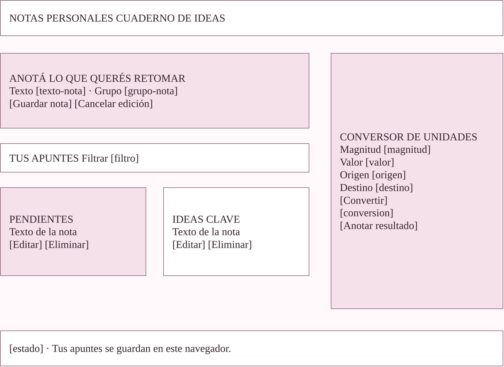
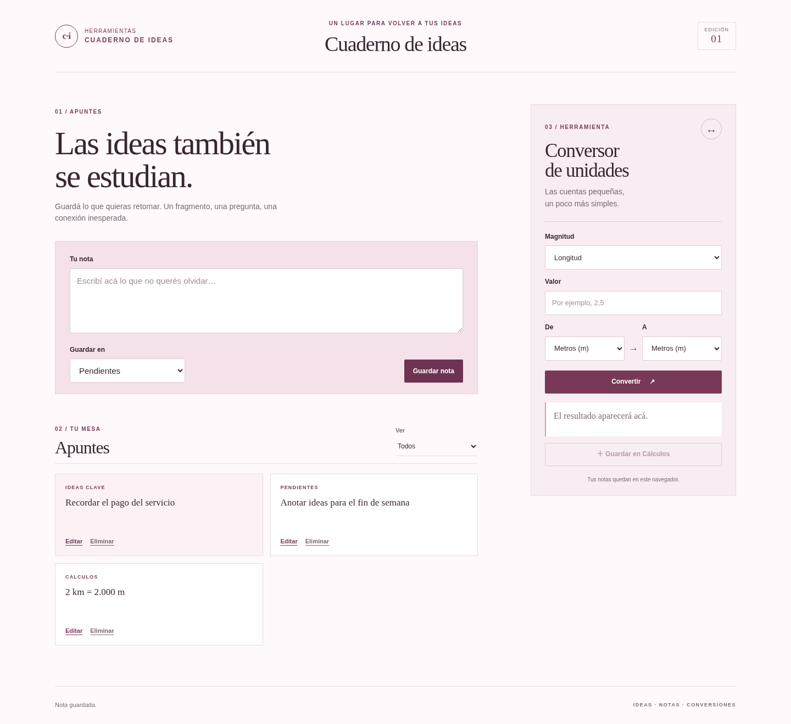

# Cuaderno de ideas

## 🧩 Datos generales

| Campo | Detalle |
| --- | --- |
| Integrante 1 | Julieta Ini |
| Integrante 2 | No corresponde: trabajo individual |
| Modelos de IA utilizados | ChatGPT; GPT-6 Luna |
| Tecnologías del proyecto | HTML5, CSS3, JavaScript, Markdown y GitHub |
| Link del repositorio | https://github.com/juliini2/pizarron-de-estudio |

## Descripción

Aplicación independiente para crear, editar, eliminar y filtrar notas, junto con un conversor de unidades de longitud, masa y temperatura. Las notas se almacenan localmente en el navegador. Una conversión se puede guardar como nota. La interfaz conserva su distribución y colores; las categorías se muestran con etiquetas breves y claras.

## Registro anterior

[README anterior (historial del repositorio)](https://github.com/juliini2/pizarron-de-estudio/blob/d84acf699a1b3d842c2cfc916b4937a6f3b02649/README.md)

## Prompt de actualización (fragmento)

```text
Neutralizá únicamente la temática de club de estudio de esta aplicación de notas y conversión, conservando colores, distribución, geometría, estructura, IDs, nombres de repositorio, URLs, claves de localStorage y todos los valores persistidos. Actualizá solo etiquetas visibles usando mapas de presentación y valores explícitos en opciones cuando hoy texto y valor coinciden. Los datos antiguos deben seguir cargando, filtrándose y editándose sin migración ni modificación de contenido. Cambiá las etiquetas de categorías Lecturas, Repaso, Repasos y Por leer a Pendientes; Dudas a Preguntas; Ejercicios a Cálculos. El botón visible Guardar en Ejercicios debe decir Guardar en Cálculos, pero conserva exactamente el valor interno Ejercicios. Usa el título indicado para esta persona y elimina menciones visibles de la marca, el club y el estudio. Actualiza documentacion.md y README.md de forma idéntica con la tabla exacta ## 🧩 Datos generales y filas Campo/Detalle, Integrante1, Integrante2, Modelos de IA utilizados, Tecnologías del proyecto, Link del repositorio; conserva los datos reales de la documentación original, usa tecnologías HTML5 CSS3 JavaScript Markdown GitHub, describe herramienta independiente y conversor sin temática escolar, enlaza el README anterior mediante /blob/<sha>/README.md bajo Registro anterior, registra este prompt exacto y el cambio local con publicación pendiente. No inventes pruebas, capturas ni cronologías.
```

## Estado

Cambio local realizado. Publicación pendiente por decisión de la persona usuaria.

## Capturas actuales

Boceto de la interfaz:



Aplicación funcionando con datos de ejemplo:



[Ver captura móvil](evidencias/aplicacion-movil.png).

Estas capturas corresponden a la versión local. El repositorio y el sitio publicados todavía conservan la versión anterior.
